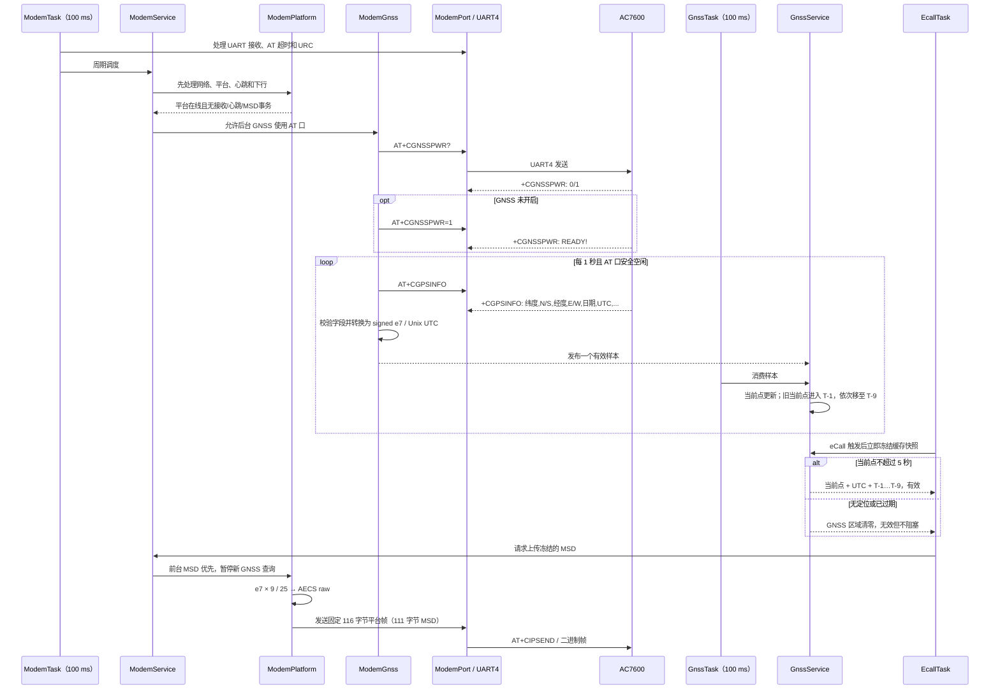

# AC7600 GNSS 接入与 eCall MSD 流程

## 结论

- 主控继续使用现有 UART4 连接 AC7600 主 AT 串口；不启用第二串口，也不把原始 NMEA 混入当前 AT/TCP/语音通道。
- AC7600 内部 GNSS 串口负责 GNSS 芯片与模组主处理器之间的数据传输；主控通过同一个 AT 串口执行 `AT+CGNSSPWR?`、`AT+CGNSSPWR=1` 和周期性 `AT+CGPSINFO` 获得解析后的定位。
- 内部坐标统一为有符号十进制度 `×10,000,000`（e7）；AECS 帧打包时转换为 eCALL_Soft 使用的 `×3,600,000`。
- 当前坐标单独传输；9 个历史坐标按新到旧排列为 `T-1` 至 `T-9`，不重复当前点。只有新的有效定位才推进历史。
- 定位查询周期为 1 秒，当前点新鲜度门限为 5 秒。无有效新鲜定位时，经纬度、UTC 和历史区清零，但 eCall 继续执行。

## 泳道图

## AECS MSD 坐标区布局

| 载荷偏移 | 长度 | 内容 | 单位/顺序 |
|---:|---:|---|---|
| 23 | 4 | 当前 UTC | Unix 秒，大端 |
| 27 | 4 | 当前经度 | 度 `×3,600,000`，大端有符号值 |
| 31 | 4 | 当前纬度 | 度 `×3,600,000`，大端有符号值 |
| 35–106 | 72 | 9 个历史点 | 每点先经度、后纬度；`T-1` 至 `T-9` |
| 107–110 | 4 | 预留传感器字段 | 本次保持 0 |

换算采用整数四舍五入：`AECS raw = round(e7 × 9 / 25)`。例如 `31.1230000°` 的内部值为 `311230000`，打包值为 `112042800`。

## 参考依据与仍需实板确认

- `eCALL_Soft/Source/1_App/GPS_Module_App/GPS_Location_Services.c`：参考定位解析和历史坐标用途；本实现修正其历史第 1 点重复当前坐标的问题。
- `eCALL_Soft/Source/1_App/4G_Module_App/4G_NetWork_Manage.c`：参考 111 字节 MSD 布局、经纬度顺序及 `×3,600,000` 单位；本实现分别按 N/S 与 E/W 判定符号。
- `A7600C-R5_硬件设计手册_V1.01(250710).pdf` 和 `A7600C-R5_GNSS_硬件应用笔记_V1.00(250715).pdf`：GNSS_TXD/RXD、UART2 内部/外部连接能力及主 AT 串口查询方案。

实板验收仍需记录实际 `+CGNSSPWR`、`+CGPSINFO` 回包，并在服务器地图或解码日志中核对正负号、坐标单位、当前点和 9 个历史点的语义。触发类型字节的 bit mask 与 eCALL_Soft 的 0/1 枚举差异不属于本次 GNSS 修改范围，需单独确认服务器协议后处理。
