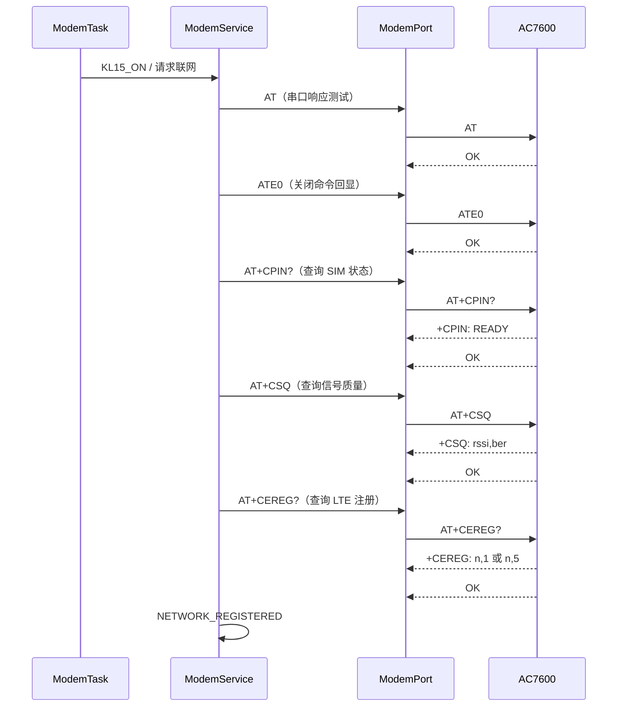
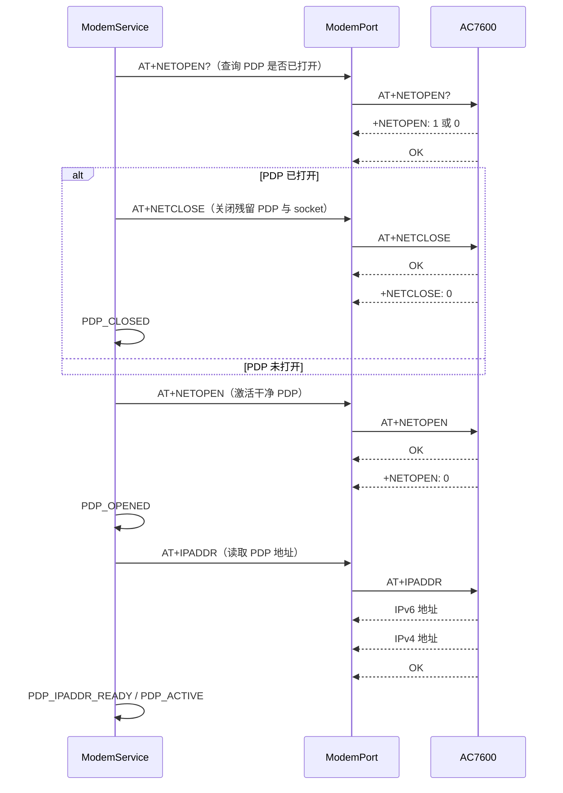
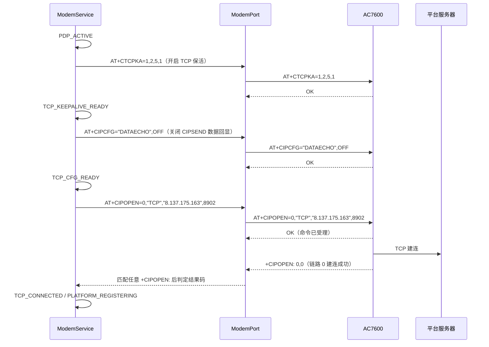
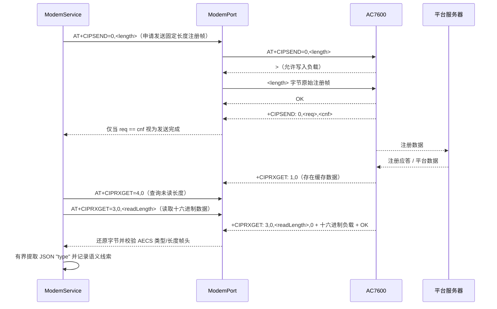
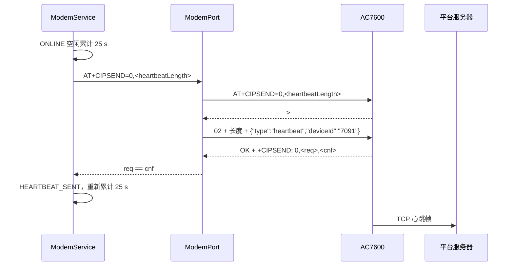

# AC7600 TCP/IP 主路径泳道图

## 目的和当前证据

本文件是 TBOX eCall 样机 AC7600 TCP/IP 主路径的可编辑 Mermaid 源文件。

- 原厂资料：`D:\TBOX\资料\小华半导体\08-4G模组\A7600C R2&A7608X-H&A7602X-H\01 APP手册\A76XX Series_TCPIP_Application Note_V1.05.pdf`。
- AT 语法资料：`D:\TBOX\资料\小华半导体\08-4G模组\A7600C R2&A7608X-H&A7602X-H\03 ATC手册\A76XX_Series_AT_Command_Manual_V2.02.pdf`。
- 实板已验证：2026-08-27，HC32 UART4 115200 bit/s，经 CH340 临时单向回传模组的 1.8 V TX 数据至 MCU；日志已确认到 `+CIPOPEN: 0,0` 和 `TCP_CONNECTED`。
- 未验证不标为完成：平台注册、平台回包解析、`CIPSEND`、MSD 上传、真实 `ATD` 外呼与失败重试。

## 总览


## 阶段 1：基础入网（实板已验证）



`+CEREG` 的注册状态为 `1`（本地）或 `5`（漫游）才进入 PDP 阶段；单独收到 `OK` 不代表已注册。

## 阶段 2：PDP 激活与地址确认（实板已验证）



实板已观察到 IPv6 与 IPv4 双栈地址。每次新网络流程若发现 PDP 已打开，会先执行 `NETCLOSE` 清除残留 socket/PDP，再重新 `NETOPEN`；`NETOPEN` 的成功条件是异步结果 `+NETOPEN: 0`，而不是先返回的 `OK`。不使用 `CRESET`，仅在连续软恢复失败时再考虑模组复位。

## 阶段 3：TCP 配置与建连（实板已验证）



`AT+CTCPKA=1,2,5,1` 的含义是：启用保活、空闲 2 分钟后探测、最多重试 5 次、探测间隔 1 分钟。`CIPOPEN` 必须等待 `+CIPOPEN: 0,0`；`+CIPOPEN: 0,<非零>` 会立即记录 `TCP_OPEN_RESULT_FAILED` 并进入休眠，避免误判或长时间等待。

当前实现对 `CIPOPEN` 失败增加了 3 次受控重试，间隔 5 秒；保留已完成的 PDP 和 TCP 配置，耗尽后才进入 `SLEEP`。

当前服务器 `8.137.175.163:8902` 是从 AECS 参考工程沿用的候选平台，已于上述样机试验中实际连接成功；其平台协议尚未冻结。

## 阶段 4：平台注册、发送与接收（实板部分验证）



当前源码已实现候选注册发送：`01 + 4 字节大端 JSON 长度 + {"role":"device","deviceId":"7091"}`，经 `CIPSEND` 的 `>` 提示符发送，并以 `+CIPSEND: 0,req,cnf` 且 `req == cnf` 判定成功。TCP 建连前会先执行 `AT+CIPRXGET=1`，平台下行只上报 `+CIPRXGET: 1,<link>`；随后查询缓存长度，并对不超过 750 字节的数据使用 `AT+CIPRXGET=3,<link>,<length>` 读回十六进制文本、还原字节并校验候选 AECS 帧头。

在帧头校验通过后，服务仅在帧内有界扫描 JSON 的 `"type":"..."`，最多记录 31 个可打印 ASCII 字符为 `PLATFORM_RX_TYPE:<value>`；不打印完整平台 JSON，也不因未知 `type` 改写当前 `ONLINE` 状态。实板已收到长度 127 的候选 AECS 帧，并确认其 `type` 为 `register_ack`；该回包的附加成功/失败字段语义仍未冻结。

### ONLINE 内的候选心跳（已实现，待实板验证）



心跳仅在平台接收空闲、没有待上传 MSD、且未请求 KL15 休眠时启动，因此不会与 `CIPRXGET` 或紧急业务竞争 UART AT 事务。CIPSEND 的提示符和长度确认与注册发送完全一致；任一步失败进入现有网络恢复路径。心跳帧内容、25 秒周期仍是 AECS 候选，需看服务器响应后再冻结。

## 阶段 5：MSD、外呼与故障恢复（MSD 候选已实现）

```mermaid
sequenceDiagram
    participant E as EcallTask
    participant S as ModemService
    participant P as ModemPort
    participant M as AC7600

    E->>S: 冻结 MSD，申请紧急服务
    S->>P: AT+CIPSEND=0,116（申请固定长度 MSD 帧）
    M-->>P: >
    P->>M: 10 + 111 字节 MSD 候选负载
    M-->>P: OK + +CIPSEND: 0,116,116
    S->>S: MSD_UPLOADED_CALL_PENDING
    Note over S,M: 此阶段不发送 ATD
    S->>P: ATD<emergencyNumber>;（下一阶段，号码与时机需授权）
    M-->>P: 呼叫结果 URC
    S-->>E: 呼叫状态 / 失败重试事件

    M-->>P: +CIPEVENT: NETWORK CLOSED UNEXPECTEDLY
    S->>P: CIPCLOSE / NETOPEN? / NETCLOSE
    S->>S: 受控重连或 eCall 失败重试

    M-->>P: +CGEV: ... PDN DEACT ...
    S->>S: 终止当前 AT 事务，AT_SYNC → NETCLOSE/NETOPEN 重建
```

当前 MSD 使用 AECS 参考工程的 111 字节负载布局：`version`、`identifier`、触发掩码、测试呼叫、车辆类型、17 字节 VIN、动力类型、UTC、经度、纬度、9 组历史点、Delta-V、乘员和翻滚。当前 TBOX 已有的触发掩码、UTC、经纬度会映射进帧；演示常量使用版本 `1`、标识 `1`、测试呼叫 `1` 与 VIN `LDC12345678900001`，其余当前没有来源的字段显式填零。外层帧使用消息类型 `0x10` 和 4 字节大端长度，因此 CIPSEND 总长度为 116 字节。

`+CIPSEND: 0,116,116` 仅证明模组已完整交付 MSD 给 TCP 栈，后续是否收到 `msd_ack` 仍待实板确认。紧急请求若撞上在途的心跳或下行读取，会等待该单笔事务结束后才进入 MSD，避免并发 AT；成功后服务保持 `CALL_PENDING` 并恢复 `ONLINE`，不会发送或模拟 `ATD`。真实外呼及其 URC、失败重试仍需用户授权。

## 当前完成度与下一步

| 项目 | 状态 | 实际证据 / 约束 |
|---|---|---|
| UART4 AT 收发 | 已验证 | AC7600 对基础 AT 和 TCP AT 均有实机响应。|
| LTE 注册 | 已验证 | `+CEREG: 0,1`。|
| PDP | 已验证 | `NETOPEN?`、`NETOPEN`、`IPADDR` 已完成；观察到 IPv4/IPv6 地址。|
| TCP | 已验证 | `CTCPKA`、`CIPCFG`、`CIPOPEN`；收到 `+CIPOPEN: 0,0`。|
| RTT 日志 | 已调整 | HMI 队列 32 条、RTT 上行缓冲 4 KiB；仍需长时间无断点观察。|
| 平台注册 | 已实板验证 | 注册帧发送完成后，实测收到 `register_ack`；附加字段语义尚未冻结。|
| CIPSEND | 已实板验证 | 已实测 `>`、固定长度原始数据与 `+CIPSEND` 长度确认。|
| 接收事件/长度 | 已实板验证 | 已实测 `CIPRXGET=1` 缓冲下行与 `CIPRXGET=4` 长度查询。|
| 接收内容/帧头 | 已实板验证 | 使用 `CIPRXGET=3` 读取最多 750 字节十六进制内容；已收到并通过 127 字节候选 AECS 类型/长度帧头校验。|
| 平台应答 type | 已实板验证 | 帧头有效后有界提取 JSON `type`；实测注册回包为 `register_ack`，附加字段语义尚未冻结。|
| 平台心跳 | 已实板验证 | ONLINE 空闲 25 秒后发送候选 43 字节 `0x02` 心跳帧，连续收到 `heartbeat_ack`；与下行接收、MSD 和 KL15 休眠互斥。|
| MSD 上报 | 已实现，待实板验证 | 发送参考兼容的 116 字节候选 MSD 帧；仅以 CIPSEND 长度确认成功。|
| ATD / 拨号重试 | 待实现 | 需要号码、呼叫 URC、失败重试策略和实板发送时机的明确授权。|
