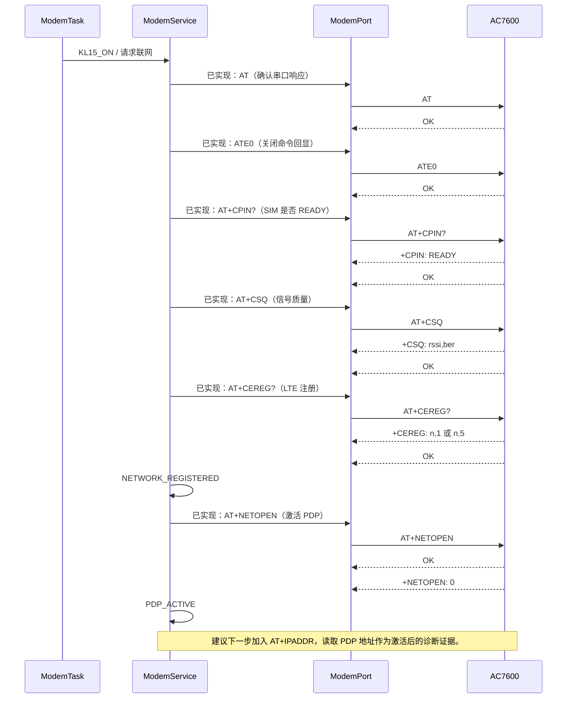
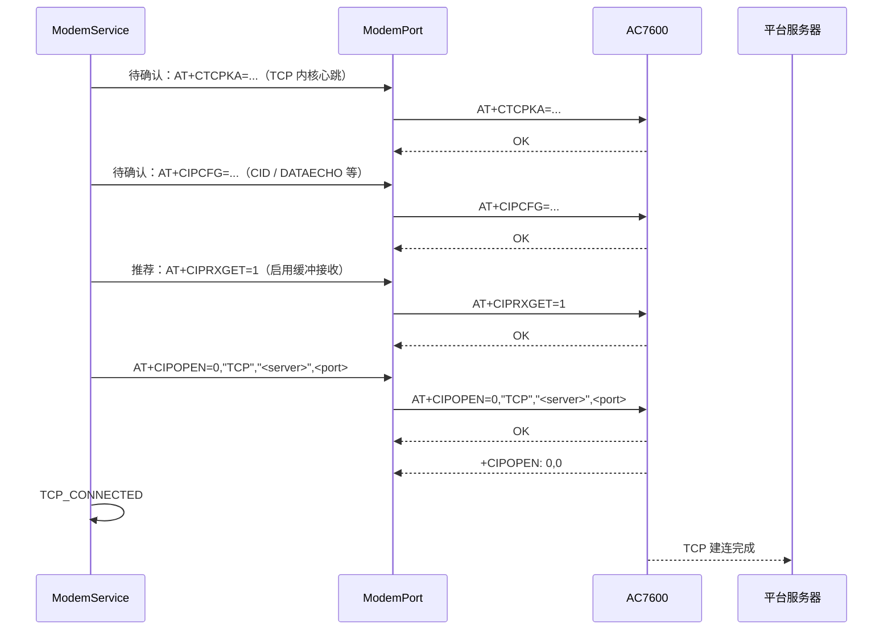
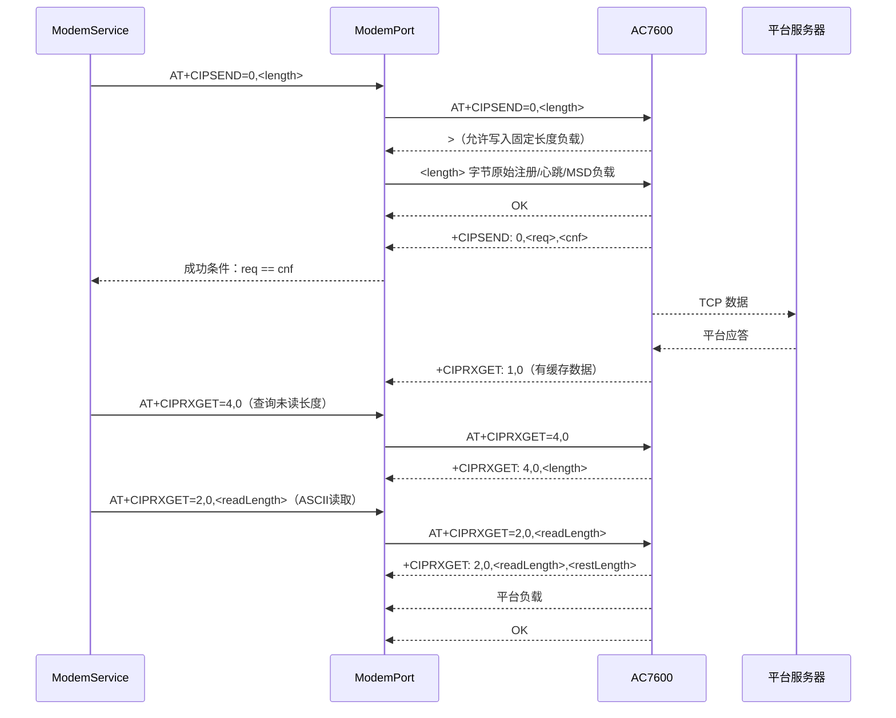

# AC7600 TCP/IP 主路径泳道图

## 目的和依据

本文件是 TBOX eCall 样机的可编辑 TCP/IP 流程图源文件。图中使用 Mermaid，修改后可在支持 Mermaid 的 Markdown 预览中直接查看。

- 原厂依据：`4G_docs/A76XX Series_TCPIP_Application Note_V1.05.pdf`，第 7、10-11、15-17、25-27 页。
- 详细 AT 语法：`4G_docs/A76XX_Series_AT_Command_Manual_V2.02.pdf` 与 `4G_docs/AC7600_AT_REFERENCE.md`。
- 标记：`已实现` 表示当前源码已有流程；`待实现` 不代表已在样机验证；`待确认` 需要以当前 AC7600 实机响应为准。

## 总览


## 阶段 1：基础入网与 PDP 激活（当前主路径）



成功条件不是单独的 `OK`：`AT+NETOPEN` 必须收到 `+NETOPEN: 0`。失败后应先用 `AT+NETOPEN?` 查询状态；应用说明建议仍无法激活时复位模组并重新检查 PDP 配置。

## 阶段 2：TCP 建连（待实现）

推荐使用 **非透传 + 缓冲接收模式**。原因是 eCall 平台数据可能为二进制帧；透明模式下不能执行 AT 命令，而默认直推模式会直接向串口输出 `+IPD<长度>` 和原始负载，当前按 CR/LF 收行的 ModemPort 无法可靠处理。



`AT+CIPOPEN` 也必须等待 `+CIPOPEN: <link>,0`。`link=0` 是当前项目候选链路号；应用说明示例使用 `link=1`，两者在非透传模式下均属于合法范围，最终由项目配置统一冻结。

## 阶段 3：平台注册、发送与接收（待实现）



对于二进制平台负载，应使用应用说明定义的十六进制读取模式 `AT+CIPRXGET=3,<link>,<length>`，或扩展 ModemPort 的长度驱动二进制接收状态；不得把二进制负载当作普通 CR/LF 文本行解析。

## 阶段 4：MSD、外呼和故障恢复（待实现）

```mermaid
sequenceDiagram
    participant E as EcallTask
    participant S as ModemService
    participant P as ModemPort
    participant M as AC7600
    participant V as 平台服务器

    E->>S: 冻结 MSD，申请紧急服务
    S->>P: AT+CIPSEND=0,<msdLength>
    P->>M: CIPSEND 命令 / 等待 > / 写 MSD 原始字节
    M-->>P: +CIPSEND: 0,<req>,<cnf>
    M-->>V: MSD 数据
    S->>P: ATD<emergencyNumber>;（需明确授权）
    P->>M: ATD...;
    M-->>P: 呼叫结果 URC（待按 AC7600 实测定义）
    S-->>E: 呼叫状态 / 失败重试事件

    M-->>P: +CIPEVENT: NETWORK CLOSED UNEXPECTEDLY
    S->>P: AT+CIPCLOSE=<link>（按连接状态处理）
    S->>P: AT+NETOPEN?（确认 PDP 状态）
    S->>P: AT+NETCLOSE（若网络库仍打开）
    S->>S: 受控重连或 eCall 失败重试
```

## 与当前主路径的差异和后续顺序

|项|当前状态|应用说明要求/建议|下一步|
|---|---|---|---|
|基础 AT、SIM、CSQ、CEREG|已实现并实机观察响应|符合|保持。|
|`NETOPEN`|已实现，等待 `+NETOPEN: 0`|符合|实机验证耗时与失败码。|
|`IPADDR`|未实现|推荐作为 PDP 激活诊断|加入 PDP_ACTIVE 入口后的只读验证。|
|接收模式|未实现|默认直推；推荐 eCall 使用 `CIPRXGET=1` 缓冲模式|先实现缓冲模式和长度读取。|
|`CIPOPEN`|仅有框架|等待 `OK` 和 `+CIPOPEN:<link>,0`|确认服务器、端口、CID 后实施。|
|`CIPSEND`|仅有框架|两阶段：`>` 后定长原始字节，最终检查 `+CIPSEND`|扩展 ModemPort 事务类型。|
|被动断线|未实现|处理 `+CIPEVENT`，释放 socket/PDP 后受控重连|在 TCP 阶段实施。|
|MSD 与 `ATD`|未实现|先上传 MSD，再真实语音外呼|确认号码、平台确认规则、呼叫 URC 和重试策略。|

