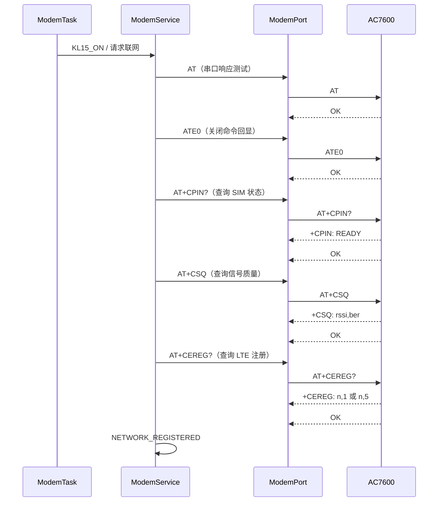
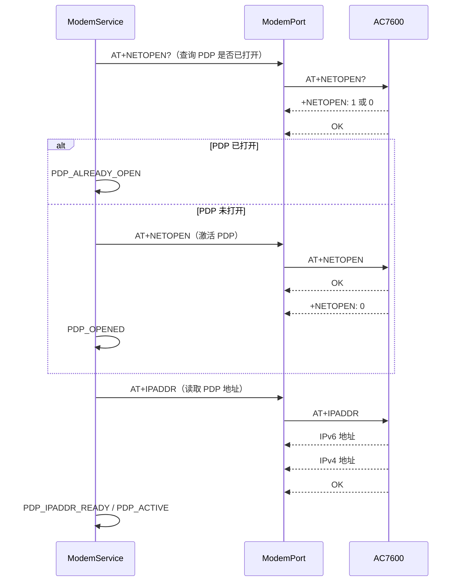
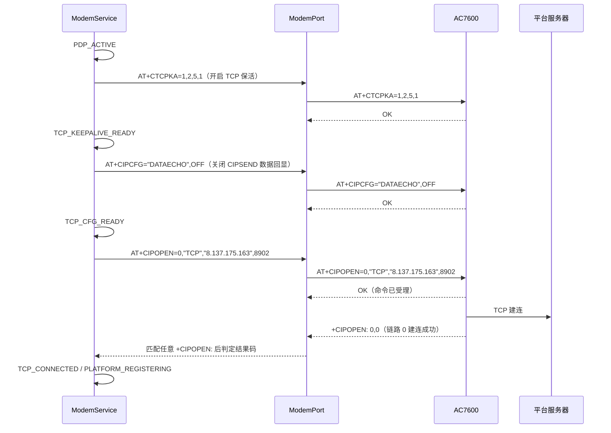
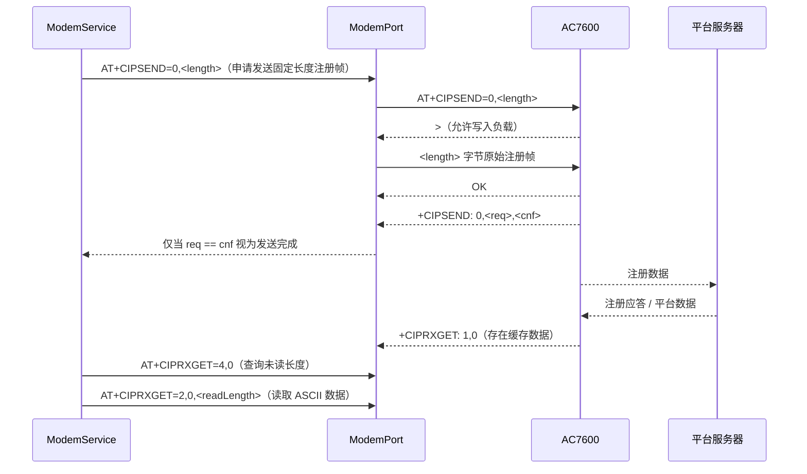

# AC7600 TCP/IP 主路径泳道图

## 目的和当前证据

本文件是 TBOX eCall 样机 AC7600 TCP/IP 主路径的可编辑 Mermaid 源文件。

- 原厂资料：`D:\TBOX\资料\小华半导体\08-4G模组\A7600C R2&A7608X-H&A7602X-H\01 APP手册\A76XX Series_TCPIP_Application Note_V1.05.pdf`。
- AT 语法资料：`D:\TBOX\资料\小华半导体\08-4G模组\A7600C R2&A7608X-H&A7602X-H\03 ATC手册\A76XX_Series_AT_Command_Manual_V2.02.pdf`。
- 实板已验证：2026-08-27，HC32 UART4 115200 bit/s，经 CH340 临时单向回传模组的 1.8 V TX 数据至 MCU；日志已确认到 `+CIPOPEN: 0,0` 和 `TCP_CONNECTED`。
- 未验证不标为完成：平台注册、平台回包解析、`CIPSEND`、MSD 上传、真实 `ATD` 外呼与失败重试。

## 总览


## 阶段 1：基础入网（实板已验证）



`+CEREG` 的注册状态为 `1`（本地）或 `5`（漫游）才进入 PDP 阶段；单独收到 `OK` 不代表已注册。

## 阶段 2：PDP 激活与地址确认（实板已验证）



实板已观察到 IPv6 与 IPv4 双栈地址。`AT+NETOPEN` 的成功条件是异步结果 `+NETOPEN: 0`，而不是先返回的 `OK`。

## 阶段 3：TCP 配置与建连（实板已验证）



`AT+CTCPKA=1,2,5,1` 的含义是：启用保活、空闲 2 分钟后探测、最多重试 5 次、探测间隔 1 分钟。`CIPOPEN` 必须等待 `+CIPOPEN: 0,0`；`+CIPOPEN: 0,<非零>` 会立即记录 `TCP_OPEN_RESULT_FAILED` 并进入休眠，避免误判或长时间等待。

当前服务器 `8.137.175.163:8902` 是从 AECS 参考工程沿用的候选平台，已于上述样机试验中实际连接成功；其平台协议尚未冻结。

## 阶段 4：平台注册、发送与接收（待实现）



平台注册报文、回包语义、心跳内容与周期尚未确认；当前 `PLATFORM_REGISTERING` 仅为状态机入口，未发送数据。二进制负载需要十六进制读取或长度驱动接收，不能按普通 CR/LF 文本行解析。

## 阶段 5：MSD、外呼与故障恢复（待实现）

```mermaid
sequenceDiagram
    participant E as EcallTask
    participant S as ModemService
    participant P as ModemPort
    participant M as AC7600

    E->>S: 冻结 MSD，申请紧急服务
    S->>P: CIPSEND 命令 / 等待 > / 写 MSD 原始字节
    M-->>P: +CIPSEND: 0,<req>,<cnf>
    S->>P: ATD<emergencyNumber>;（号码与时机需授权）
    M-->>P: 呼叫结果 URC
    S-->>E: 呼叫状态 / 失败重试事件

    M-->>P: +CIPEVENT: NETWORK CLOSED UNEXPECTEDLY
    S->>P: CIPCLOSE / NETOPEN? / NETCLOSE
    S->>S: 受控重连或 eCall 失败重试
```

## 当前完成度与下一步

| 项目 | 状态 | 实际证据 / 约束 |
|---|---|---|
| UART4 AT 收发 | 已验证 | AC7600 对基础 AT 和 TCP AT 均有实机响应。|
| LTE 注册 | 已验证 | `+CEREG: 0,1`。|
| PDP | 已验证 | `NETOPEN?`、`NETOPEN`、`IPADDR` 已完成；观察到 IPv4/IPv6 地址。|
| TCP | 已验证 | `CTCPKA`、`CIPCFG`、`CIPOPEN`；收到 `+CIPOPEN: 0,0`。|
| RTT 日志 | 已调整 | HMI 队列 32 条、RTT 上行缓冲 4 KiB；仍需长时间无断点观察。|
| 平台注册 | 待实现 | 缺少已确认的注册帧和平台应答规则。|
| CIPSEND / 接收 | 待实现 | ModemPort 仍是行式 AT 事务，尚不支持 `>` 与二进制长度收发。|
| MSD / ATD / 重试 | 待实现 | 需要 MSD 格式、号码、呼叫 URC 和重试策略的明确授权。|

